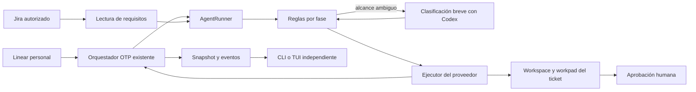

# Symphony personal

Propuesta para revisión · 26 de noviembre de 2026

## Alcance y punto de partida

Este proyecto extiende el fork de OpenAI Symphony en Elixir/OTP. Al revisar, `main` del fork y `main` de upstream apuntaban a `be10a1b`. El checkout local incluye el incremento autorizado que lee Jira desde Linear y selecciona un ejecutor por estado. Esa implementación es optativa. El diseño de cuentas, flujos adaptativos, persistencia y TUI queda sujeto a revisión antes de pasar a código.

La primera prueba útil es un cambio acotado de Blaze que entre con un enlace de Jira, deje criterios verificables, llegue a Mauricio con la demo real y mantenga el control humano sobre publicación y merge. El mismo servicio debe admitir tickets personales o universitarios con su propio contexto y permisos.

## Qué conservar del motor

| Pieza existente | Comportamiento observado | Límite o extensión |
| --- | --- | --- |
| `Workflow`, `WorkflowStore` y `Config` | Leen YAML y una plantilla Liquid, validan y recargan el archivo. Una recarga inválida conserva la última configuración válida. | Añadir campos optativos y plantillas de fase en la configuración existente. |
| Trackers y tickets normalizados | El adaptador obtiene candidatos y refresca sus estados. Linear, Jira Cloud, GitHub Issues, GitLab y Asana están incluidos. | Linear conserva la identidad del trabajo. Jira aporta requisitos y contexto a tickets de Blaze. |
| `Orchestrator` y supervisión OTP | Evalúa filtros, prioridad, cupos, claims y estados activos. Reintenta fallos con espera creciente y reconcilia estados al consultar el tracker. El supervisor reinicia juntos el orquestador y sus workers si corresponde. | La política de elección pertenece al ejecutor. Los registros duraderos empiezan como historial operativo. |
| `Workspace` y hooks | Preparan, reutilizan y limpian carpetas por ticket. La sesión puede correr localmente o por SSH en el camino original. | Un único escritor por ticket. El catálogo autorizado resuelve los repositorios. Un caso multi-repo usa subdirectorios del mismo workspace. |
| `AgentRunner` y Codex App Server | Abre la sesión, envía turnos y consulta el estado entre turnos. El protocolo JSON-RPC entrega eventos, herramientas y bloqueos. | Los adaptadores de Claude y Antigravity viven en el límite de ejecución. La sesión de Codex conserva su protocolo. |
| CLI, dashboard de terminal, Phoenix LiveView y API | La CLI inicia el servicio. Los dashboards presentan el snapshot. La API expone estado, detalle de ticket y actualización de polling. | La TUI se conecta al daemon. Los controles persistentes y un stream de eventos con cursor son trabajo futuro. |
| Logs y consumo | Se correlacionan tickets y sesiones. El consumo de Codex distingue datos acumulados de incrementos. El estado operativo de claims, reintentos y bloqueos vive en memoria. | Registrar eventos por proveedor con sus unidades y fuentes. El reinicio necesita una reconciliación explícita antes de incorporar efectos externos duraderos. |

El YAML del ejemplo consulta Linear cada cinco segundos. Un ticket elegible pasa al agente cuando hay cupo. Con la configuración original, los cambios de estado que hace el agente determinan qué continúa y qué queda esperando. [Upstream y su especificación](https://github.com/openai/symphony) · [App Server](https://developers.openai.com/codex/app-server) · [Contabilidad de uso en el fork](../elixir/docs/token_accounting.md)

## Tu flujo por proyecto

| Paso | Blaze | Personal y universidad |
| --- | --- | --- |
| Entrada | Creas un `Todo` personal con el enlace a Jira. Si el enlace no resuelve a un proyecto y repositorios autorizados, se registra el bloqueo. | El ticket de Linear trae el encargo o referencia a la fuente del proyecto. Se cargan solo las instrucciones y el corpus del curso correspondiente. |
| Investigación | Jira da requisitos y aclaraciones. Cuando sean relevantes y estén autorizados, el agente consulta Slack, Notion o diagnóstico de entorno. Lee los contratos entre repositorios y las instrucciones del proyecto antes de planear. | Se usa el repositorio, la documentación y las fuentes autorizadas del proyecto. |
| Plan | Un workpad privado en Linear reúne alcance, criterios, pasos y pruebas. Cada criterio queda abierto hasta que su evidencia esté registrada. Se distinguen contradicciones de requisitos y decisiones pendientes. | El mismo formato puede reducirse a criterios y validación para cambios pequeños. |
| Implementación y revisión | Se reutilizan las rutas normales y las pruebas del repo. La revisión parte del diff, el contrato y las consecuencias para consumidores. Se hace una segunda lectura independiente conforme a la skill aplicable, con revisión humana según el pipeline. | Se elige si hace falta una segunda lectura según el riesgo y la regla de ese proyecto. |
| Demo | La UI real si evidencia el cambio. Para API-only en Payment Service y ECOM, Hoppscotch en la colección existente. Se reutiliza el request por método y ruta, incluso si cambia un campo. Se registra un solo request por endpoint nuevo con las convenciones del equipo y la autorización correspondiente. Platform y servicios sin colección en Hoppscotch usan Bruno. | Superficie real del proyecto y evidencia que responda al criterio, con el formato acordado por proyecto. |
| Entrega | Video en inglés con cursor visible, envío real, estado HTTP y respuesta original cuando corresponda. Hoppscotch aporta el enlace interno verificado de colección y request. Bruno aporta el cURL sanitizado. El paquete se prepara localmente para la aprobación de Mauricio antes de publicar, pedir revisión o mover al estado corporativo de revisión. El merge sigue su aprobación específica. | Los estados de aprobación, publicación y merge los define el proyecto. |

### Cómo aplicar las preferencias de Tiago

El agente de revisión carga primero las reglas vigentes del repositorio. Busca observaciones de Tiago relacionadas con el componente o el tipo de cambio, fecha y decisión vigente. Traducir una observación en una comprobación concreta es parte de la revisión. Una decisión de otro ticket conserva su alcance y una preferencia histórica pierde prioridad si el dueño corrigió el contrato.

La salida vincula cada criterio con código y prueba, comprueba el flujo real que usa el consumidor, y señala una regresión verificable con disparador, impacto y corrección acotada. Se da prioridad al cambio mínimo suficiente, reutilizar el flujo y el dato autoritativo, mantener la selección de proveedores y el mapeo en sus capas y evitar decisiones de concurrencia o persistencia sin una necesidad demostrada. La revisión del agente es evidencia técnica. El visto bueno humano se registra por separado.

En Blaze se aplican las skills locales `blaze-engineering` y `blaze-reviewer`, la referencia `tiago-principles.md` y el pipeline nativo. Cuando Codex es responsable, comparte con Claude el contexto mínimo de cada fase activa y verifica lo que recibe. Symphony puede programar directamente esa segunda lectura y conservar el registro local de la consulta. Una fase liderada por Claude evita consultarse a sí misma. Los comentarios de Jira, ADRs y PRs de Blaze presentan decisiones, resultados y aprobaciones sin adjuntar el historial privado de agentes.

## Alternativas revisadas

| Alternativa | Qué aprovecho | Límite para este proyecto |
| --- | --- | --- |
| Upstream Elixir | Código de supervisión, cola, reconciliación, cancelación, workspace y contratos de observabilidad. | El ejecutor original arranca Codex. |
| `oh-my-symphony` | La fuente de backends muestra adaptadores dueños de sus procesos, eventos normalizados y sesiones de distinta duración. Sus reglas por estado y gates verificables son referencias concretas. | Está escrito en Python y su registro SQLite y su interfaz son parte de otra arquitectura. |
| `symphony-agnostic` | Demuestra selección por etiquetas y wrappers que adaptan otros agentes. | Ejecuta un poller por agente. Una decisión central en el fork conserva la autoridad de claims y simplifica el relevo. |
| Agent Client Protocol | Ofrece un contrato publicado de sesión, herramientas, permisos y cancelación para clientes y agentes compatibles. | Evaluarlo si una integración concreta lo necesita. La compatibilidad y las funciones disponibles dependen del proveedor y de la versión. |

[Backends de oh-my-symphony](https://github.com/cskwork/oh-my-symphony/blob/main/src/symphony/backends/__init__.py) · [Configuración de oh-my-symphony](https://github.com/cskwork/oh-my-symphony/blob/main/docs/reference.md) · [symphony-agnostic](https://github.com/seyoon-han/symphony-agnostic) · [ACP v1](https://agentclientprotocol.com/protocol/v1/overview)

## Ejecución y arquitectura propuesta



### Capacidades de ejecución

| Proveedor | Integración inicial | Capacidades y límites que importan |
| --- | --- | --- |
| Codex | App Server original para trabajo y CLI en solo lectura para clasificación | Sesión y turnos, aprobaciones y herramientas dinámicas, cancelación y señales de uso. El fork preserva ese camino. |
| Claude Code | CLI en modo no interactivo con eventos JSON | La CLI y el Agent SDK tienen salida estructurada. El SDK ofrece control programático de permisos y sesiones, justificable si el piloto exige callbacks o reanudación. El primer incremento consume el resultado de la ejecución y emite progreso. |
| Antigravity con Gemini | CLI `agy` con streaming JSON | Documenta sesiones, mensajes estructurados, modelos y uso. Se debe verificar el permiso real del worker, el acceso al modelo y qué eventos expone la versión instalada en la prueba piloto. |

La preferencia inicial de Sol para ejecución rutinaria combina su integración existente y la mayor cuota de Mauricio. Astra queda para diagnósticos o cambios amplios dentro de Codex. Claude sirve para una revisión independiente y Gemini Neon para documentación extensa o evidencia multimedia. Terminal-Bench 4.1 mide tareas de terminal, con configuraciones y herramientas distintas. Su cercanía entre Sol y Neon sustenta que la selección dependa del tipo de trabajo y de las métricas locales. La evaluación de Google sobre video y contexto largo es una hipótesis para el piloto. [Claude Code headless](https://code.claude.com/docs/en/headless) · [Antigravity headless](https://antigravity.google/docs/cli/headless/) · [Modelos de Antigravity](https://antigravity.google/docs/models) · [Terminal-Bench 4.1](https://www.tbench.ai/?open_in_browser=true) · [Evaluación de Neon](https://storage.googleapis.com/deepmind-media/gemini/gemini_4_neon_model_evaluation.pdf)

Cuando otro ejecutor necesite más capacidades, el contrato podrá distinguir sesión persistente, streaming, reanudación, adjuntos, herramientas del tracker, permisos, cancelación y forma de medir consumo. El evento común debería llevar ticket, fase, intento, proveedor, modelo y perfil local, secuencia, tiempo y tipo. El cuerpo autorizado se limita a progreso, uso del proveedor, bloqueo o desenlace. Los campos propios de cada proveedor se conservan en un detalle privado y filtrado. Los dashboards deben seguir consumiendo el snapshot compatible durante la transición.

### Asignación y ejecución por fase

1. El estado y el proyecto definen la fase. El router comprueba repositorio, acceso a datos, herramientas y capacidad de ejecución. Un override explícito del operador respeta los mismos límites.
2. En una fase configurada para clasificar, la falta de criterios explícitos o una indicación de alcance incierto permite una consulta breve. La respuesta del modelo produce una categoría validada. Los criterios que falten siguen pendientes de aclaración. La política decide qué candidatos autorizados pueden ejecutar esa categoría. El incremento actual usa el mecanismo de reintento ante un fallo del clasificador. El piloto debe comprobar un límite para esos reintentos y una forma explícita de dejar el alcance pendiente.
3. Para un cambio pequeño, implementación, pruebas y evidencia pueden permanecer en una sesión. Si el ticket tiene varios componentes, una migración o un contrato delicado, se justifica planificación, revisión independiente y una comprobación específica antes del paso humano. Un aumento de alcance pide replanificación a partir del diff y la última evidencia.
4. Cuando el tracker cambia de fase, el ejecutor termina su intento y el siguiente reutiliza el workspace. Dos lectores pueden investigar instantáneas si el riesgo y la cuota lo justifican. Cada checkout de implementación conserva un único escritor. Las fases paralelas y los grafos de dependencias se justifican con un caso piloto concreto.
5. La decisión explica por qué eligió a ese agente y qué alternativas eran elegibles. La primera política usa reglas. Más adelante, disponibilidad y resultados históricos pueden desempatar perfiles autorizados. Mantener revisión y corrección dentro de un presupuesto de intentos, con un bloqueo explícito al agotarlo.

### Cuentas, uso y credenciales

La propuesta de registro distingue identidad local del perfil, proveedor, método de autenticación, estado, modelos autorizados, organización y repositorios permitidos, capacidades, concurrencia y última observación. La observación de cuota incluye tipo de ventana, reinicio, unidad y fuente. Sus estados son medido, estimado y desconocido. Desconocido se presenta como tal. Se registran límites y gasto sin guardar tokens en la base, en prompts o en evidencia.

Cada worker arranca con la identidad autorizada para su proyecto. Las implementaciones futuras deben demostrar cómo se aísla cada perfil con el mecanismo soportado por ese proveedor antes de incorporarlo al registro. Para la cuenta institucional, la lista de repositorios autorizados empieza vacía hasta que se confirme el alcance. Ante límite, se espera el reinicio, se usa capacidad adicional autorizada o se considera otro proveedor habilitado para el mismo trabajo. Un error de autenticación o permisos se presenta como bloqueo. Las suscripciones y el consumo por API se registran con sus propias unidades y condiciones. [OpenAI autenticación y uso](https://learn.chatgpt.com/docs/auth) · [Claude Code costes y créditos](https://code.claude.com/docs/en/costs) · [Antigravity autenticación](https://antigravity.google/docs/install) · [Términos de OpenAI](https://openai.com/policies/terms-of-use/)

### Relevo, persistencia y seguridad

El relevo usa un registro breve con fuente y revisión del requerimiento, criterios pendientes, repo y ref, resumen del diff, pruebas ejecutadas y sus salidas útiles, hallazgos abiertos, evidencia y próxima acción. El workspace conserva archivos y el workpad conserva el estado que se puede compartir. Las sesiones persistentes sirven dentro de un proveedor. Entre proveedores se comparte ese registro y los artefactos necesarios.

La primera lectura de Jira guardará una referencia de la revisión usada en el plan, por ejemplo su fecha de actualización y un hash de los requisitos pertinentes. Si difiere en una fase posterior, el paquete debe señalar qué criterios requieren reevaluación. La lectura actual aporta la última versión visible en cada intento. El registro de revisión del requisito forma parte del contrato de relevo pendiente.

Conservar la cola y reconciliación de OTP para el primer piloto. Guardar después un historial acotado de intentos y decisiones, con permisos por proyecto, antes de persistir leases. SQLite local con WAL es una opción cuando la recuperación del historial o las medidas repetibles lo necesiten. Su escritura vive en un solo host y las pruebas deben cubrir caída inmediatamente antes y después de publicar un efecto. Un checkpoint de borrador y una intervención humana no pueden reverificarse solo a partir de un código de salida. [SQLite WAL](https://sqlite.org/wal.html)

El URL de Jira identifica un ticket del origen configurado. El motor construye la llamada HTTPS, suprime redirecciones en la entrada y quita los secretos del tracker y del lector de Jira declarados en el entorno del agente. Los CLIs usan su propia autenticación autorizada. Cualquier texto de un ticket o comentario se trata como material de trabajo. La autorización de repositorios, operaciones y destino se fija fuera del ticket. Para Blaze, la señal que autoriza publicar o hacer merge debe provenir de una identidad humana verificada para el ticket y la versión de la evidencia. El agente puede registrar progreso, pero una transición hecha por su identidad solo cambia la cola. El daemon mantendrá la API en loopback por defecto, y los futuros controles requieren autorización y claves de idempotencia. La recuperación debe probar una única ejecución activa por ticket y evitar dobles PRs, escrituras repetidas y pérdida de evidencia. [API de Jira Cloud](https://developer.atlassian.com/cloud/jira/platform/rest/v3/api-group-issues/)

## Observabilidad y evaluación

Registrar por intento proveedor, modelo, fase, clase de trabajo, tamaño aproximado, riesgo, razón de la ruta, duración, desenlace, recompilaciones y retrabajo. Las métricas de revisión cuentan defectos confirmados por el responsable, con evidencia, y cuánto trabajo añadieron o evitaron. Las señales de uso preservan su unidad, ventana y calidad. El historial omite secretos, cuerpos de tickets externos y transcripciones privadas.

Primero levantar una línea base con Codex en tickets comparables. En una segunda muestra elegir pares con criterios y riesgo parecidos, o repetir tareas cerradas sobre copias aisladas del mismo commit. Revisar los entregables sin mostrar el proveedor cuando sea viable. Comparar aceptación al primer intento, tiempo desde `Todo` hasta revisión, minutos humanos, defectos confirmados, retrabajo y cuota por proveedor. Registrar curación de tests, aprobaciones y casos excluidos. Examinar medianas y dispersión antes de sacar reglas de muestras pequeñas, y cambios por dificultad antes de interpretar una tasa de éxito agregada.

## CLI y TUI

El primer cliente reutiliza `/api/v1/state` y detalle de ticket. El prototipo será de solo lectura y sin dependencia de un daemon nuevo. Para reconectar, toma snapshot y recupera eventos desde un cursor cuando esté disponible. Ante un hueco, renueva el snapshot. El daemon conserva la ejecución cuando el cliente se cierra. Los futuros comandos con efecto usan las mismas operaciones autorizadas que la interfaz de terminal. Orden propuesto de comandos tras el piloto: `status`, `issue`, `logs`, `doctor`, luego `pause`, `resume`, `retry` y `route`.

| Opción | Ventaja | Coste |
| --- | --- | --- |
| Go con Bubble Tea, Lip Gloss y Bubbles | Cliente distribuible por separado, programa basado en eventos y componentes separados del motor. | Nuevo toolchain y contrato de API que versionar. |
| Elixir con Owl | Menos lenguajes. El dashboard actual y los bloques en vivo sirven para un cliente sencillo. | Un tablero interactivo con varios paneles y navegación exige un prototipo adicional antes de elegirlo. |
| Ratatui | Control del render y la disposición con un cliente compilado. | Introduce Rust y más decisiones de integración para este piloto. |
| Ink | Un equipo con experiencia en React puede iterar rápido. | Añade Node y un runtime distinto para distribución local. |

Recomiendo empezar con el dashboard existente. Si el piloto muestra que hace falta navegación de tickets y revisión desde la terminal, comparar un prototipo del detalle con Bubble Tea y uno mínimo en Elixir. Si el contrato HTTP alcanza para el cliente, Go es una opción razonable. El boceto usa la jerarquía de una herramienta operativa, teclado primero. El agente se reconoce por sigla y color secundario. El estado siempre aparece como texto. Una mascota compacta responde a eventos reales y puede desactivarse junto con el movimiento. [Bubble Tea](https://github.com/charmbracelet/bubbletea) · [Owl.LiveScreen](https://owl.hexdocs.pm/Owl.LiveScreen.html) · [Ratatui](https://github.com/ratatui/ratatui) · [Ink](https://github.com/vadimdemedes/ink)

```text
Cola                                    Conectado   2 en ejecución
Proyecto          Ticket              Fase       Estado
Blaze             Endpoint nuevo      Demo       Espera aprobación
Universidad       Caso de prueba      Implement. En ejecución [CX]
Personal          Importación         Análisis    Espera cupo

Enter Detalle     / Buscar     p Proyecto     e Eventos
```

```text
Endpoint nuevo                          Demo     Espera aprobación
Criterios    [x] Devuelve el campo    [x] Mantiene el contrato
Evidencia   Demo verificada   Hoppscotch   Pruebas
Decisión    Codex implementó. Revisión independiente por contrato.
Eventos     Implementación terminada · Revisión · Demo lista

Esc Cola     o Abrir evidencia     Tab Cambiar panel
```

```text
Agentes y cuentas                       Uso observado
[CX] Codex       Activo      Principal        Ventana conocida
[CL] Claude      Libre       Revisión         Cuota desconocida
[GM] Gemini      Espera      Perfil personal  Reinicio pendiente

Esc Cola     / Filtrar     Enter Ver estado del perfil
```

A 80 columnas, la vista de ticket se apila bajo el encabezado y la tabla prioriza fase y estado. A 120 columnas, el detalle puede convivir con la cola. Validar teclado, foco, ASCII, contraste y modo sin animación. Estos son wireframes de texto para discusión.

## Roadmap y criterios

| Fase | Entrega acotada | Criterio de salida y dependencias |
| --- | --- | --- |
| Descubrimiento | Revisar este diseño y los ADRs. Confirmar qué parte del incremento previo entra al piloto. | Mauricio elige un tablero de prueba, un repositorio y límites de publicación. |
| Piloto del workflow | Jira de lectura, ruta por fase, evidencia y aprobación en un ticket pequeño. | Un enlace resuelve requisitos sin cambiar Jira, aparecen casillas, un estado claro omite clasificación, la fase cambia de proveedor en el mismo workspace, y se verifica una demo y su enlace o cURL. Requiere entorno y autenticación de prueba. |
| Ejecución y relevo fiable | Contrato de eventos, checkpoint, preflight y condiciones de pausa y reanudación. | Pruebas de transición externa, cancelación, fallo de autorización, timeout, reinicio y escrituras idempotentes. Depende de resultados del piloto. |
| Cuentas y observabilidad | Perfiles autorizados, límites observables, atribución de decisiones e historial local. | Estado desconocido distinguible, registros sin credenciales y trazas que explican la ruta. Depende de métodos oficiales de autenticación y de qué datos expone cada proveedor. |
| Medición y adaptación | Muestra controlada, reglas evaluadas por clase de cambio y escalamiento. | Comparación reproducible contra Codex y evidencia de que cada regla mejora una métrica relevante sin empeorar el control humano. |
| CLI y TUI | Cliente de solo lectura y luego controles autorizados. | Puede reconectar y cargar una cola sin detener el daemon. Las acciones pasan por la misma autorización y quedan auditadas. Depende de snapshot estable y contrato de eventos. |

Mantener sincronizado el upstream con cambios de integración pequeños. Las extensiones viven junto a los límites existentes y usan opciones sin efecto por defecto. Verificar el camino original en cada actualización y añadir un fixture de compatibilidad si cambia App Server. Registrar una nueva decisión cuando haga falta modificar el contrato de procesos, persistencia, tracker o control. [Configuración que admite el incremento](../elixir/README.md#personal-linear-queue-with-jira-intake-and-multiple-agents) · [ADR de ejecutores](adr-0001-execution-and-routing.md) · [ADR de intake](adr-0002-linear-jira-intake.md)

### Decisiones para el piloto

- El proyecto Linear y los nombres de estados que permiten preparar, pausar y retomar trabajo. Hasta configurarlos, el YAML incluido sigue siendo el ejemplo upstream.
- El alcance real de Jira y los repositorios asociados. Una fase multi-repo necesita un catálogo explícito y una revisión de credenciales.
- El perfil de Antigravity autorizado para datos de Blaze. La disponibilidad en la cuenta universitaria requiere confirmación del entorno y sus reglas.
- El alcance de las demos que requieren acceso a un cliente de escritorio, entorno autenticado y grabación. El worker local y la prueba con una colección real siguen por verificar.
- Cómo registrar la aprobación y el paquete de evidencia sin copiar información de Blaze a una superficie personal fuera de su alcance autorizado.
