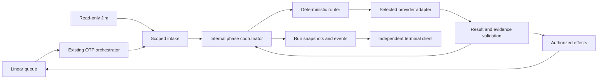

# Personal Symphony

Design revision 2 · Proposed for review · November 26, 2026

## Decision in review

Extend the existing Elixir/OTP engine. Keep its trackers, polling, claim ownership,
worker supervision, workspace hooks, priority, retry, reconciliation, cleanup and
Codex App Server path. Add an opt-in phase coordinator at the runner boundary.
Symphony selects the agent and owns progress, gates and external updates. Linear
remains the operator's queue and Jira supplies read-only requirements for linked work.

The branch currently implements an opt-in **state-to-provider mapping** and linked
Jira intake alongside the upstream path. Internal phases, centralized tracker writes,
durable recovery, adaptive routing, account isolation and the TUI described here are
proposals. See the [roadmap and verification evidence](personal-symphony-roadmap.md).

| Existing boundary | Proposed extension |
| --- | --- |
| `Workflow`, `WorkflowStore`, `Config` | Parse optional project references and policies. Pin the resolved policy version to an attempt. Recheck live permission revocations at dispatch and before effects. |
| Tracker adapters and normalized issues | Tracker state controls eligibility, priority and cancellation. A linked Jira revision supplies requirements. Only intentional milestones are projected back to Linear. |
| `Orchestrator`, worker supervisor and `AgentRunner` | Keep one claim and the existing worker lifecycle. An opt-in coordinator chooses the next internal phase. The orchestrator reserves slots and fences stale workers. |
| `Workspace` and hooks | Keep existing allocation and cleanup. Freeze the input revision for each phase and permit one writer. Allow parallel read-only research later when supported by immutable snapshots and spare capacity. |
| Codex App Server and local CLI runner | Keep App Server native. Launch other providers directly using version-specific adapters under the same claim. |
| Phoenix presenter, dashboard and API | Keep the existing snapshot contract. A separate terminal client consumes snapshots and, later, scoped history and controls. |

The bundled workflow polls every five seconds. An eligible ticket starts at
the next scheduler opportunity when capacity is available. The original mode still
uses tracker states to drive the agent. The internal mode fits within the same claim
and uses its own phase state. [Upstream specification](../SPEC.md) ·
[Workflow ADR](adr-0003-internal-workflow.md)

## Internal phases

Start with a small versioned transition table in Elixir. Resolve a run to a short
sequence using project policy, task type and risk. Each phase declares required
capabilities, artifact inputs, write mode, completion gate and attempt budget.
Workflow YAML may choose a policy and set limits. Revisit a graph interpreter only
after concrete projects exceed the table's expressive power.

| Phase | Typical exit evidence |
| --- | --- |
| Intake and planning | Approved repository resolution, requirement revision, criteria, checks and unresolved questions. Material missing requirements wait for the owner. |
| Implementation | A single writer produces a diff or commit against known inputs. Small tasks may combine this phase with validation. |
| Validation | The verifier records commands, exit status, environment and evidence against each criterion. For an observable change, use the real product UI or approved native API client and verify the recording. |
| Independent review | Required by project policy or risk. The reviewer sees a frozen diff and applicable guidance. Resolve material findings or return for a bounded correction and revalidation. |
| Human review | The engine prepares the permitted workpad and evidence references, then parks at the configured milestone. Publication and merge have separate approvals. |

A project can omit optional phases, insert a limited investigation or request a
second review. The same provider can handle several consecutive phases. A medium task
may use one implementation session and a second reviewer. A later stage can join
parallel investigations for a cross-repository contract after the serial workflow
is verified. Failures and review corrections have separate budgets. Proposed
defaults are two retries for a retryable phase and one review correction. In
internal mode, the coordinator determines whether retry is allowed, and the
orchestrator's existing retry queue schedules it. A capacity wait uses no worker
slot or failure budget. Completion, intervention and exhausted budgets release
the worker and record an admission hold across polls and restarts. The operator
must explicitly resume or enroll a new run. See the [recovery decision](adr-0003-internal-workflow.md).

Define how Linear milestones map to internal actions in the project policy. An
operator move to an inactive state stops the attempt and retains its checkpoint.
A terminal move cancels any worker, confirms it is gone and applies the existing
cleanup policy. External changes and internal milestones can race. Refresh the
authoritative tracker revision before applying a pending transition and defer when
the observed state conflicts with its expected predecessor. When the destination
lacks conditional writes, re-read the result and flag conflicts for reconciliation.
Require manual action where a concurrent change could make an unsafe write irreversible.

## Agent router

The router selects a tuple of provider, model, effort, approved profile and execution
mode for each phase. It also records whether the policy calls for independent
review. Start deterministic, with no network call for routing a clear task.

1. **Resolve facts.** Use the project identifier, authorized repositories, language
   and stack, criteria, risk and required tools to produce a small decision input.
   A Jira or Linear author can contribute facts. The local policy owns permissions,
   budget and candidate configuration.
2. **Resolve ambiguity once.** If missing information can change phase selection
   or risk and local facts cannot resolve it, allow one read-only Codex classification
   per requirement revision. Supply only the minimum approved context and require
   a small enum and rationale. Verify the classifier's identity and authorization for
   this data before sending any requirement text. If that check fails, scope stays
   unresolved. A missing business or engineering requirement stays open for the owner. A timeout or malformed answer leaves an
   explicit unresolved result and follows the project's conservative path.
3. **Filter eligibility.** Require project and data access, model availability,
   tool and effort support, online identity, a valid workspace policy, and reviewer
   independence where required. A cooling-down or saturated candidate is deferred.
   Keep capability and model catalogs at the provider boundary.
4. **Rank eligible candidates.** Start with an ordered policy over required
   capability fit, same-session continuity, available capacity and budget.
   Favor Codex when other factors are comparable to reflect available capacity.
   Pin low effort for straightforward work and raise it only for a material
   increase in complexity, risk or failure history. Treat undocumented effort as
   unsupported. Across providers use explicit candidate sets and measured time or
   cost in their native units. Keep a stable tie-breaker.
5. **Reserve and record.** The router returns a decision without taking a slot.
   The orchestrator reserves global and profile capacity atomically. Bind and
   verify the selected identity inside the execution boundary before transmitting
   the prompt. Persist a compact decision with evidence version, policy version,
   chosen candidate, rejected candidates with reason codes, capacity observations,
   and any override. A retry keeps the same binding and checkpoint when valid.
   Rescore at an approved handoff or when availability requires another decision.
   Missing eligible capacity waits or requests intervention.

Manual overrides originate in operator-owned local policy until authenticated controls
are available. Tracker text cannot set an override. Scope a recorded decision to
a phase or run, capture author and rationale, and expire it when its scope changes. The same eligibility and approval
rules apply. A meaningful override might request a specific model for a review or
pin the current provider for a follow-up. An attempt already executing finishes,
or is cancelled and drained before replacement.

For example, a routine fix with a valid Codex session and all required tools
can keep Codex at the configured low effort. When its project requires
independent review, the implementation attempt is ineligible for that review.
If Gemini has the required access and quota while Claude is cooling down,
Symphony can schedule Gemini and record the rule, deferred candidate and
cooldown expiry. The decision records capability and evidence, even when
its final ranking uses a simple configured preference.

Begin with project-specific capability hypotheses, such as long-context research,
routine code changes or independent review. Avoid assigning permanent roles to
providers. Keep an evidence table by task class, repository family, risk, provider,
model, effort and policy version. Compare equivalent cases, retain sample size and
uncertainty and use a global prior for sparse groups. After the pilot, run policy
candidates in shadow mode using recorded decisions, then permit a bounded opt-in
real comparison on low-risk tasks. Promote a policy after a human reviews the
paired evidence and preserve rollback. Record outcome and human signals separately
from model self-assessment. See the [evaluation plan](personal-symphony-roadmap.md#comparison-with-a-codex-only-workflow).

## Permissions and authority

- Resolve a repository catalog outside ticket content. Authorize a tuple of data
  scope, repository, action, profile and execution boundary. Run corporate,
  university course and personal contexts in separate policy and credential scopes.
  Keep corporate configuration, skills, reviewer notes and local evidence outside
  the public repository. Move example-specific rules out of the legacy workflow
  prompt once the project profile is supported, and preserve their verification gates.
- Centralize tracker mutation, shared collection edits, evidence publication, and
  GitHub write operations. Disable mutable tracker tools, inherited connector
  credentials and unrestricted publishing access for internal-mode workers. Use host
  identity and sandbox policy to protect credentials, other worktrees and network
  destinations even when an agent can run commands.
- Treat issue text, code, review feedback, test output and agent results as data.
  Validate result type, size, ownership, scope and referenced artifacts before
  changing state. Only the engine may mark criteria verified after checking the
  evidence. Use explicit human approval when the criterion requires judgment.
- Validate approvals with actor, destination, action, revision of the change,
  evidence digest and policy revision. An approval must come from a verified human
  identity whose credentials are unavailable to the daemon and workers. Recheck
  current authorization and tracker state before an external effect. Bind requests to an idempotency key and reconcile
  ambiguous outcomes before retrying. Keep approval for posting and merge separate.
- Preserve one workspace writer across retries, cancellation and restart. Reject
  stale results by attempt generation. Verify subprocess-tree shutdown before
  releasing the write lease or cleaning up. Start the pilot on a single local host.

The current fork strips configured reader and tracker environment variables from
headless workers, validates a declared workspace path, and protects Jira intake with
origin, project and redirect checks. These are partial controls. The inherited
environment, native credentials, managed plugins, arbitrary shell commands and
the original Codex tracker tools must be addressed before relying on centralized
enforcement for corporate data.

## More detail

- [Internal orchestration and durable results](adr-0003-internal-workflow.md)
- [Provider, model, profile and quota design](personal-symphony-providers.md)
- [Router and profile ADR](adr-0004-routing-and-profiles.md)
- [Terminal console concepts and read-only slice](personal-symphony-tui.md)
- [Terminal client ADR](adr-0005-independent-terminal-client.md)
- [Roadmap, pilot and validation](personal-symphony-roadmap.md)
- [Current execution ADR](adr-0001-execution-and-routing.md) and [Jira intake ADR](adr-0002-linear-jira-intake.md)
