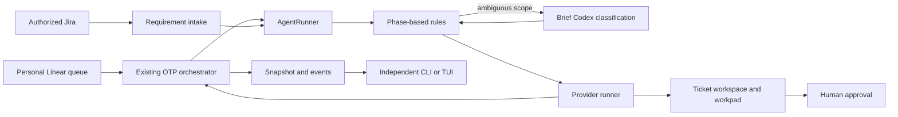

# Personal Symphony

Proposed for review · November 26, 2026

## Scope and baseline

This project extends the Elixir/OTP fork of OpenAI Symphony. At the time of review, both the fork's `main` and upstream `main` pointed to `be10a1b`. The fork branch includes the authorized increment to read Jira through Linear and select an agent by state. That behavior is opt-in. Account management, adaptive workflows, persistence, and the TUI require design review before implementation.

The first useful pilot is a small Blaze change that starts with a Jira link, produces verifiable acceptance criteria, and reaches Mauricio with a recording of the real flow. Publication and merge remain under human control. The same service must support personal and university tickets with their own context and permissions.

## Existing engine components to keep

| Component | Observed behavior | Boundary or extension |
| --- | --- | --- |
| `Workflow`, `WorkflowStore`, and `Config` | Read YAML and a Liquid template, validate them, and reload the file. An invalid reload preserves the last valid configuration. | Add optional fields and phase templates in the existing configuration. |
| Trackers and normalized issues | The adapter fetches candidates and refreshes their states. Linear, Jira Cloud, GitHub Issues, GitLab, and Asana are included. | Linear owns the work item identity. Jira supplies requirements and context for Blaze tickets. |
| `Orchestrator` and OTP supervision | Applies filters, priority, concurrency limits, claims, and active states. Retries failures with backoff and reconciles states against the tracker. The supervisor restarts the orchestrator and workers together when necessary. | Agent selection belongs at the execution boundary. Durable records start with operational history. |
| `Workspace` and hooks | Prepare, reuse, and clean up per-ticket directories. The original execution path can run locally or over SSH. | Allow one writer per ticket. Resolve repositories from the authorized catalog. A cross-repository ticket uses subdirectories of the same workspace. |
| `AgentRunner` and Codex App Server | Open the session, submit turns, and check the ticket state between turns. JSON-RPC carries events, tools, and blockers. | Claude and Antigravity adapters live at the execution boundary. Codex retains its native protocol. |
| CLI, terminal dashboard, Phoenix LiveView, and API | The CLI starts the service. The dashboards show a snapshot. The API exposes service state, ticket details, and a polling refresh. | The TUI connects to the daemon. Persistent controls and an event stream with a cursor are future work. |
| Logs and usage | Logs correlate tickets and sessions. Codex usage distinguishes cumulative totals from increments. Claims, retries, and blockers live in memory. | Record each provider's events with their units and sources. Restart recovery needs explicit reconciliation before adding durable side effects. |

The example YAML polls Linear every five seconds. An eligible ticket goes to an agent when a slot opens. In the original workflow, the state changes made by the agent determine which work continues and which work waits. [Upstream and specification](https://github.com/openai/symphony) · [App Server](https://developers.openai.com/codex/app-server) · [Usage accounting in the fork](../elixir/docs/token_accounting.md)

## Workflow by project

| Step | Blaze | Personal and university |
| --- | --- | --- |
| Intake | Create a personal `Todo` ticket with the Jira link. Record a blocker if the link cannot be resolved to an authorized Jira project and set of repositories. | The Linear ticket contains the request or references the project's source. Load only the instructions and materials for the relevant course. |
| Research | Jira supplies requirements and clarifications. Where relevant and authorized, consult Slack, Notion, or environment diagnostics. Read cross-repository contracts and project instructions before planning. | Use the repository, documentation, and authorized sources for the project. |
| Plan | A private Linear workpad tracks scope, acceptance criteria, steps, and tests. Leave each criterion open until its evidence is recorded. Identify conflicting requirements and decisions that still need an owner. | For small changes, the same format can be limited to acceptance criteria and validation. |
| Implementation and review | Reuse the repository's normal entry points and tests. Start the review from the diff, the contract, and its effect on consumers. Follow the applicable skill for an independent second pass and the project pipeline for human review. | Determine whether an independent pass is needed based on the risk and the project's rules. |
| Demo | Use the real UI when it demonstrates the change. For API-only changes in Payment Service and ECOM, use the existing Hoppscotch collection. Reuse the request by method and route, including when an existing field changes. Register one request per new endpoint using team conventions and the appropriate authorization. Use Bruno for Platform and services without a Hoppscotch collection. | Use the actual product surface and evidence that addresses the criterion, in the format agreed for the project. |
| Delivery | Record in English with the cursor visible. For API demos, show the actual send, HTTP status, and original response where relevant. Hoppscotch supplies the verified internal collection and request links. Bruno supplies sanitized cURL. Prepare the package locally for Mauricio's approval before publishing, requesting review, or moving the corporate ticket to its review state. Merge has its own approval. | The project defines the approval, publication, and merge states. |

### Applying Tiago's review guidance

The reviewer first loads the current repository rules. It looks for Tiago's feedback that applies to the component or kind of change, including its date and the decision currently in effect. The review turns relevant feedback into specific checks. Decisions from another ticket retain their scope, and historical guidance yields when the owner has corrected the contract.

The review maps each criterion to code and a test, checks the entry point that the consumer actually uses, and describes each verified regression with its trigger, impact, and a focused correction. Favor the smallest sufficient change, reuse the existing flow and authoritative data, keep provider selection and mapping in their owning layers, and add concurrency or persistence only when the change demonstrably needs it. Agent review provides technical evidence. Human approval is recorded separately.

For Blaze, use the local `blaze-engineering` and `blaze-reviewer` skills, the `tiago-principles.md` reference, and the repository's own pipeline. When Codex owns a phase, it shares the minimum relevant context with Claude and verifies the feedback. Symphony can schedule that second pass directly and keep a local record of the consultation. For Claude-led phases, any consultation uses a separate reviewer. Blaze Jira comments, ADRs, and PRs present decisions, results, and approvals without attaching private agent history.

## Alternatives reviewed

| Alternative | Useful ideas | Limits for this project |
| --- | --- | --- |
| Upstream Elixir | Supervision, queueing, reconciliation, cancellation, workspace management, and observability contracts. | The original runner launches Codex. |
| `oh-my-symphony` | The backend source shows adapters that own their processes, normalize events, and support sessions of different lengths. State-based routing and verifiable gates are concrete references. | It is written in Python. Its SQLite registry and interface belong to a different architecture. |
| `symphony-agnostic` | Shows label-based selection and wrappers for additional agents. | Runs a poller for each agent. A central decision in this fork preserves claim ownership and simplifies handoff. |
| Agent Client Protocol | Publishes a contract for sessions, tools, permissions, and cancellation for compatible clients and agents. | Evaluate it when a specific integration calls for it. Compatibility and available features vary by provider and version. |

[oh-my-symphony backends](https://github.com/cskwork/oh-my-symphony/blob/main/src/symphony/backends/__init__.py) · [oh-my-symphony configuration](https://github.com/cskwork/oh-my-symphony/blob/main/docs/reference.md) · [symphony-agnostic](https://github.com/seyoon-han/symphony-agnostic) · [ACP v1](https://agentclientprotocol.com/protocol/v1/overview)

## Proposed execution architecture



### Execution capabilities

| Provider | Initial integration | Relevant capabilities and limits |
| --- | --- | --- |
| Codex | Original App Server for execution and a read-only CLI for classification | Sessions and turns, approvals and dynamic tools, cancellation, and usage signals. The fork preserves this path. |
| Claude Code | Non-interactive CLI with JSON events | Both the CLI and Agent SDK offer structured output. The SDK adds programmatic control for permissions and sessions, which could be useful if the pilot needs callbacks or resumption. The initial increment reads the result and emits progress. |
| Antigravity with Gemini | `agy` CLI with JSON streaming | Documents sessions, structured messages, models, and usage. The pilot must verify worker permissions, model access, and events from the installed version. |

The initial preference for Sol on routine work reflects the existing integration and Mauricio's greater Codex quota. Astra is available for diagnostics and larger changes within Codex. Claude offers independent review, and Gemini Neon is a candidate for long documentation or multimedia evidence. Terminal-Bench 4.1 measures terminal tasks under different settings and tools. The close scores for Sol and Neon support using task type and local metrics for selection. Google's results for video and long context provide a hypothesis for the pilot. [Claude Code headless](https://code.claude.com/docs/en/headless) · [Antigravity headless](https://antigravity.google/docs/cli/headless/) · [Antigravity models](https://antigravity.google/docs/models) · [Terminal-Bench 4.1](https://www.tbench.ai/?open_in_browser=true) · [Neon evaluation](https://storage.googleapis.com/deepmind-media/gemini/gemini_4_neon_model_evaluation.pdf)

When another runner needs additional capabilities, its contract can distinguish persistent sessions, streaming, resumption, attachments, tracker tools, permissions, cancellation, and usage accounting. A common event should carry the ticket, phase, attempt, provider, model, local profile, sequence, timestamp, and type. The permitted payload covers progress, provider usage, blockers, or outcomes. Provider-specific fields remain in a private, filtered detail record. Dashboards should continue to consume the compatible snapshot during the transition.

### Phase routing and execution

1. The state and project define the phase. The router checks the repository, data access, tools, and available execution capacity. An explicit operator override follows the same limits.
2. In phases configured for classification, missing explicit criteria or an ambiguity signal allows a brief model call. The response becomes a validated category. Missing criteria remain open for clarification. The policy determines which authorized candidates can handle the category. The current increment uses the existing retry behavior if classification fails. The pilot should verify a cap for those retries and an explicit way to leave the scope unresolved.
3. For a small change, one session can cover implementation, tests, and evidence. Multiple components, a migration, or a sensitive contract can justify planning, independent review, and a targeted check before human review. An increase in scope calls for revisiting the plan using the diff and the latest evidence.
4. When the tracker moves to another phase, the current runner finishes its attempt and the next runner reuses the workspace. Two readers can investigate snapshots if the risk and quota justify it. Each implementation checkout retains a single writer. Parallel phases and dependency graphs need a concrete pilot scenario.
5. Each routing decision records why the agent was selected and which alternatives were eligible. The initial policy is rule-based. Later, availability and historical results can break ties among authorized profiles. Review and correction stay within an attempt budget, with an explicit blocker when it runs out.

### Accounts, usage, and credentials

The proposed account registry distinguishes the local profile identity, provider, authentication method, status, authorized models, permitted organization and repositories, capabilities, concurrency, and last observation. Quota observations include window type, reset time, unit, and source. Their status is measured, estimated, or unknown. Show unknown values as such. Record limits and spend without storing credentials in the database, prompts, or evidence.

Each worker starts with the identity authorized for its project. Future implementations must verify how the provider supports profile isolation before adding that provider's profiles to the registry. The institutional account starts with an empty repository allowlist until its scope is confirmed. When a quota runs out, wait for the reset, use approved additional capacity, or consider another provider authorized for the same work. Authentication and authorization errors are surfaced as blockers. Track subscriptions and API usage using their respective units and terms. [OpenAI authentication and usage](https://learn.chatgpt.com/docs/auth) · [Claude Code costs and credits](https://code.claude.com/docs/en/costs) · [Antigravity authentication](https://antigravity.google/docs/install) · [OpenAI Terms of Use](https://openai.com/policies/terms-of-use/)

### Handoff, persistence, and security

A handoff is a short record with the source and revision of the requirements, open criteria, repository and ref, diff summary, test commands and useful output, open findings, evidence, and next action. The workspace preserves files and the workpad preserves shareable state. Persistent sessions help within one provider. Across providers, share the handoff and the artifacts needed for the next phase.

The first Jira read will record the revision used for planning, such as its update time and a hash of the relevant requirements. If the revision changes in a later phase, the handoff must identify the criteria that need another look. The current implementation reads the latest visible version on each attempt. Recording the requirement revision is part of the pending handoff contract.

Keep the OTP queue and reconciliation for the first pilot. Add a bounded history of attempts and routing decisions with project-level permissions before persisting leases. Local SQLite with WAL is an option when recovering history or collecting repeatable measurements calls for it. Writes stay on one host, and tests must cover crashes just before and after publishing a side effect. A process exit code alone cannot establish that a draft checkpoint or human approval is still valid. [SQLite WAL](https://sqlite.org/wal.html)

A Jira URL identifies an issue on the configured origin. The engine constructs the HTTPS request, disables redirects for intake, and removes the declared tracker and Jira reader secrets from the agent environment. The CLIs use their own authorized authentication. Treat ticket and comment text as work material. Repository, operation, and destination permissions are set outside the ticket. For Blaze, publication or merge must be authorized by a verified human identity for the ticket and the matching evidence revision. The agent can record progress, and a transition made with its identity only changes the queue. The daemon will keep the API on loopback by default. Future control operations require authorization and idempotency keys. Recovery must prove that only one run is active per ticket and prevent duplicate PRs, repeated writes, and loss of evidence. [Jira Cloud API](https://developer.atlassian.com/cloud/jira/platform/rest/v3/api-group-issues/)

## Observability and evaluation

Record the provider, model, phase, task category, approximate size, risk, routing reason, duration, outcome, rebuilds, and rework for each attempt. Review metrics track findings confirmed by the owner, the evidence that supports them, and the work they added or prevented. Usage observations retain their unit, window, and quality. History excludes secrets, external ticket bodies, and private transcripts.

First collect a Codex baseline on comparable tickets. Then select pairs with similar acceptance criteria and risk, or replay closed tasks in isolated copies of the same commit. When feasible, review the outputs without identifying the provider. Compare first-pass acceptance, time from `Todo` to review, human time, confirmed defects, rework, and quota use by provider. Record test selection, approvals, and excluded cases. Examine medians and variability before drawing rules from small samples. Compare by difficulty before interpreting an aggregate success rate.

## CLI and TUI

The first client reuses `/api/v1/state` and the ticket detail endpoint. The prototype is read-only and uses the existing daemon. On reconnect, it gets a snapshot and retrieves events from a cursor when available. If there is a gap, it refreshes the snapshot. The daemon keeps running when the client closes. Future commands with side effects use the same authorized operations as the terminal interface. After the pilot, start with `status`, `issue`, `logs`, and `doctor`, then add `pause`, `resume`, `retry`, and `route`.

| Option | Benefit | Cost |
| --- | --- | --- |
| Go with Bubble Tea, Lip Gloss, and Bubbles | Separately distributable client with an event-driven program and components independent of the engine. | An additional toolchain and an API contract to version. |
| Elixir with Owl | One more client without adding another language. The existing dashboard and live blocks support a simple interface. | A multi-pane interactive board needs another prototype before selection. |
| Ratatui | Direct control of rendering and layout in a compiled client. | Introduces Rust and more integration decisions during the pilot. |
| Ink | A team familiar with React can iterate quickly. | Adds Node and a separate runtime for local distribution. |

Start with the existing dashboard. If the pilot shows a need for ticket navigation and review from the terminal, compare a Bubble Tea ticket detail prototype with a minimal Elixir implementation. Go is a reasonable option if the HTTP contract meets the client's needs. The wireframe follows an operator console hierarchy with keyboard-first controls. An abbreviation and secondary color identify the agent. State always appears as text. An optional compact mascot responds to actual events, and motion can be disabled. [Bubble Tea](https://github.com/charmbracelet/bubbletea) · [Owl.LiveScreen](https://owl.hexdocs.pm/Owl.LiveScreen.html) · [Ratatui](https://github.com/ratatui/ratatui) · [Ink](https://github.com/vadimdemedes/ink)

```text
Queue                                   Connected   2 running
Project           Ticket              Phase       State
Blaze             New endpoint        Demo        Awaiting approval
University        Test case           Implement   Running [CX]
Personal          Import              Analysis    Waiting for a slot

Enter Details    / Search    p Project    e Events
```

```text
New endpoint                            Demo      Awaiting approval
Criteria     [x] Returns the field    [x] Preserves the contract
Evidence    Verified demo   Hoppscotch   Tests
Decision    Codex implemented. Independent review for contract risk.
Events      Implementation complete · Review · Demo ready

Esc Queue    o Open evidence    Tab Switch pane
```

```text
Agents and accounts                     Observed usage
[CX] Codex       Active    Primary           Known window
[CL] Claude      Idle      Review            Quota unknown
[GM] Gemini      Waiting   Personal profile  Reset pending

Esc Queue    / Filter    Enter Profile details
```

At 80 columns, ticket details stack below the heading and the table prioritizes phase and state. At 120 columns, details can sit alongside the queue. Verify keyboard navigation, focus, ASCII mode, contrast, and the option to disable motion. These are text wireframes for review.

## Roadmap and exit criteria

| Phase | Scoped deliverable | Exit criteria and dependencies |
| --- | --- | --- |
| Discovery | Review this design and the ADRs. Confirm which parts of the existing increment belong in the pilot. | Mauricio chooses a test board, a repository, and publication limits. |
| Workflow pilot | Read-only Jira intake, phase routing, evidence, and approval on one small ticket. | A link resolves requirements without changing Jira, acceptance checkboxes appear, a clear scope skips classification, a new phase changes provider in the same workspace, and a demo and its link or cURL are verified. Requires a test environment and authentication. |
| Reliable execution and handoff | Event contract, checkpoint, preflight, and pause and resume behavior. | Tests cover out-of-band transitions, cancellation, failed authorization, timeouts, restart, and idempotent writes. Depends on the pilot results. |
| Accounts and observability | Authorized profiles, observable limits, routing attribution, and local history. | Unknown values are distinguishable, records contain no credentials, and traces explain routing. Depends on the documented authentication methods and each provider's available data. |
| Measurement and adaptation | Controlled sample, per-category rule evaluation, and escalation. | A repeatable comparison against Codex and evidence that each rule improves a relevant metric while preserving human control. |
| CLI and TUI | Read-only client followed by authorized controls. | The client can reconnect and load the queue without stopping the daemon. Actions share the same authorization path and are audited. Depends on a stable snapshot and event contract. |

Keep the branch in sync with upstream through small integration changes. Extensions stay next to the existing boundaries and have no effect unless enabled. Verify the original execution path during each update and add a compatibility fixture when App Server changes. Record an ADR when a change affects the process, persistence, tracker, or control contract. [Configuration supported by the increment](../elixir/README.md#personal-linear-queue-with-jira-intake-and-multiple-agents) · [Execution ADR](adr-0001-execution-and-routing.md) · [Intake ADR](adr-0002-linear-jira-intake.md)

### Decisions for the pilot

- Choose the Linear project and the states for preparing, pausing, and resuming work. The bundled YAML remains the upstream example until the pilot is configured.
- Confirm the Jira scope and corresponding repositories. Cross-repository work needs an explicit catalog and a credentials review.
- Identify the Antigravity profile authorized to handle Blaze data. Availability of the university account depends on its environment and rules.
- Confirm which demos need desktop access, an authenticated environment, and recording. The local worker and a run against the real collection still need verification.
- Decide how to record approval and the evidence package while keeping Blaze information within its authorized scope.
